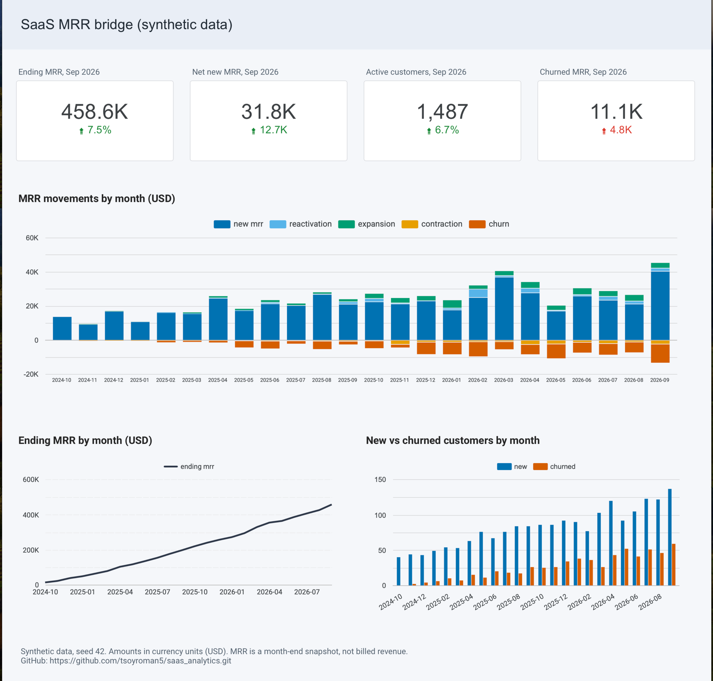

# SaaS subscription analytics: MRR bridge with dbt and BigQuery

> **All data in this project is synthetic.** It comes from a seeded generator (`ingestion/generate_saas_data.py`, seed 42). Nothing here describes a real company.

A small analytics engineering project: raw subscription events go in, a tested monthly MRR bridge comes out. The data is synthetic on purpose. Because the generator also writes the true answers, every number in the pipeline is reconciled against ground truth, which real data never allows.

**What you can check in this repo**

- A month-end MRR model whose output matches the generator's ground truth for all 24 months, column by column, and for every customer-month (16,311 customer-months with MRR).
- A layered dbt project (staging, intermediate, marts) with documented models and 119 tests.
- Reconciliation tests that compare the models with the true answers and fail when they disagree.
- A GitHub Actions workflow that builds and tests the project on every pull request in a throwaway BigQuery dataset, and removes it afterwards, including when the build fails.
- A one-page dashboard on top of the MRR bridge ([live report](https://datastudio.google.com/reporting/dd613ca5-e68f-4744-a918-9f65db5dc96f), screenshot below).

## Dashboard



[Open the live report](https://datastudio.google.com/reporting/dd613ca5-e68f-4744-a918-9f65db5dc96f) (Looker Studio, view only). It reads the `mrr_monthly` table directly; all figures are in currency units (cents divided by 100) and the data is synthetic.

| Panel | What it shows |
|---|---|
| Scorecards (Sep 2026, change against Aug 2026) | ending MRR, net new MRR (ending minus starting), active customers, churned MRR |
| MRR movements by month | stacked columns: new, reactivation and expansion above zero; contraction and churn below zero |
| Ending MRR by month | the month-end MRR trend |
| New vs churned customers by month | clustered columns on a single axis |

Two details worth knowing: ending MRR and active customers are month-end snapshots, so the scorecards are fixed to a single month and never add values across months. The dashboard reads the development dataset (`dbt_dev`), not a separate production one; see the limitations below.

**Stack:** BigQuery (`asia-northeast3`), dbt 2.x, Python (generator and loader), GitHub Actions, Looker Studio.

## Architecture

```
generator (Python)  ->  CSV batches  ->  load_to_bq.py  ->  raw_saas.*  (string columns + _batch_date)
                                                                |
        staging (views)         cast types, rename, dedupe on event_id  (5 models)
                                                                |
        intermediate (tables)   int_customer_month_mrr          one row per customer per month, month-end state
                                int_customer_mrr_movements      each customer-month classified against the previous month
                                                                |
        marts (table)           mrr_monthly                     the MRR bridge, one row per calendar month
```

Other pieces: the seed `plan_prices` (price per seat per month in cents, by plan and billing interval) and the ground-truth tables `raw_saas.truth_*`, which are used only by tests tagged `truth`.

### Repository layout

| Path | Contents |
|---|---|
| `ingestion/` | data generator and BigQuery loader |
| `dbt/models/` | `staging/`, `intermediate/`, `marts/`, with a YAML file of descriptions and tests per model |
| `dbt/tests/` | singular tests: bridge identities and `reconciliation/` (tagged `truth`); custom generic test in `tests/generic/` |
| `dbt/seeds/` | `plan_prices.csv` |
| `dbt/ci/profiles.yml` | the CI profile: settings and `env_var(...)` only, no secrets |
| `.github/workflows/ci.yml` | the pull request workflow |
| `docs/metrics.png` | screenshot of the dashboard |
| `docs/DESIGN.md` | the original design. Section 2 (metric definitions) is current; the model list and plan in sections 3 and 8 were simplified during the build |

## Metric definitions

MRR is a **month-end snapshot** of subscriptions, not billed revenue. Changes that start and end inside one month net out; a customer who signs up and cancels in the same month is never counted. The truth files follow the same rule.

- **Customer MRR** = seats x price per seat for the customer's plan and billing interval. It is **0 when the last event up to month end is `canceled`**. A canceled event still carries the old plan and seats, so the event type is checked first. Annual plans use the discounted per-seat price, expressed per month.
- **Month-end state** = the latest event strictly before the first instant of the next month (exclusive upper boundary, no lower bound).
- **Movements**, comparing each customer's MRR with the previous month end:

| Movement | Rule |
|---|---|
| new | previous MRR 0, now > 0, never had MRR before |
| reactivation | previous MRR 0, now > 0, had MRR in an earlier month |
| expansion | previous > 0, now higher |
| contraction | previous > 0, now lower but > 0 |
| churn | previous > 0, now 0 |

- **Bridge identity (tested):** starting MRR + new + reactivation + expansion - contraction - churn = ending MRR. Contraction and churn are signed (negative) in the intermediate model and shown as positive amounts in `mrr_monthly`.

## Testing

The last CI build ran 8 models, 1 seed and 119 tests: 127 nodes passed and 1 test raised the expected warning.

| Type | Examples | What it catches |
|---|---|---|
| Generic | `not_null`, `accepted_values`, `unique_combination_of_columns` (dbt_utils) | broken keys, unexpected plan or event values, duplicate customer-months |
| Custom generic | `is_non_negative` on MRR and movement amounts | sign errors that would otherwise be hidden |
| Singular, identities | movement amount bridges last month's MRR to this month's; the monthly bridge adds up to ending MRR; starting MRR equals the customer-level sum of the previous month | logic errors that survive column-level tests |
| Reconciliation (tag `truth`) | `mrr_monthly` and `int_customer_month_mrr` against `raw_saas.truth_*`, using a full outer join so missing rows are caught as well as wrong ones | definitions that are consistent but wrong |

Singular tests return the offending rows and pass on zero rows. Comparisons are null-safe.

**Known warning:** about 590 product events refer to a customer that does not exist (`cus_999999`). This is planted in the generator. The `relationships` test on `stg_product_events` is set to `warn` on purpose: such events are kept in staging and reported, not deleted. The product events are not used by the MRR models.

## CI

On every pull request to `main` (`.github/workflows/ci.yml`):

1. Install the pinned dbt version and the dbt packages.
2. Write the service account key from a GitHub secret to a temporary file with owner-only permissions. The workflow never prints it.
3. `dbt build --target ci` into a dataset named `ci_pr_<number>` (the seed goes to `ci_pr_<number>_raw`). The models read the persistent `raw_saas` data and the truth tables.
4. Delete both datasets in steps that always run, whether the build passed or failed. A failed deletion makes the run red.

Safeguards: minimal workflow permissions, one run at a time per pull request, a timeout, and no run for pull requests from forks (they get no secrets). Tested both ways: a normal pull request builds green, and a deliberately malformed input fails the build while both datasets are still removed.

## Bugs the tests caught during the build

| Bug | How it showed up | Fix |
|---|---|---|
| Canceled month still had MRR | the canceled event carries the old plan and seats, so MRR was calculated from them | read `event_type` first; canceled means 0 |
| Churn labeled as contraction | the order of the `case` branches | reordered, and checked against truth |
| First month labeled expansion | `lag` over an empty window returned null | default the previous MRR to 0 |
| Wrong sign hidden by `abs()` | totals looked plausible | explicit sign handling plus `is_non_negative` tests |
| Join in the wrong direction | events on the left side of the join dropped months with no event | the customer-month skeleton goes on the left |
| Reconciliation test that always failed | an aggregate query always returns one row | tests return offending rows, not counts |
| Reconciliation test blind to missing rows | left join only sees rows that exist on one side | full outer join with keys coalesced across both sides |
| `<>` ignoring nulls | a null on one side silently passed | `is distinct from` |
| 64 CI tests erroring | the CI service account lacked the BigQuery Read Session User role | role added |

## Decisions and limitations

- **Synthetic data.** Results show that the pipeline is correct, not that any business behaves this way.
- **Month-end snapshots** hide intra-month movements.
- **Tie-breaking.** When two events of one customer have the same timestamp, the month-end model does not break the tie deterministically. This is a known, documented assumption. The reconciliation with ground truth shows that it has no effect on this dataset, but it is not enforced.
- **Orphan product events** are warned about, not rejected (see above).
- **The dashboard reads the development dataset.** There is no separate production target yet, so rebuilding `dbt_dev` locally changes what the dashboard shows. The live report is a free Looker Studio link and may not stay up, which is why the screenshot is part of this README.
- **CI depends on persistent raw data.** The workflow reads `raw_saas` and the truth tables; it does not regenerate them.
- **CI credentials.** The service account has project-wide BigQuery Data Editor so it can create and delete per-pull-request datasets. A production setup would restrict it further.
- One currency, no taxes, discounts, proration, refunds or trials.
- The generator and the models share one author, with AI help. Agreement between them shows that the definitions are applied consistently, not that they are the right ones for any real company.

## Run it

Requirements: Python 3, a GCP project with BigQuery, and `gcloud` authenticated.

```
# 1. Generate the synthetic data (deterministic)
cd ingestion
pip install -r requirements.txt
python generate_saas_data.py --out generated

# 2. Load it into BigQuery (dataset raw_saas)
python load_to_bq.py --data generated/data --project <your-gcp-project> --backfill-through 2026-09-30
```

Then load the ground-truth CSVs from `generated/truth/` into `raw_saas` as tables with the same names (`truth_customer_month_mrr`, `truth_mrr_monthly`). I did this once by hand with the BigQuery console's upload option (CSV, header row skipped). The `month` column is read as text in the reconciliation tests. Without these tables the tests tagged `truth` cannot run; the rest of the project builds without them (`dbt build --exclude tag:truth`).

```
# 3. Build and test
cd ../dbt
pip install -r requirements.txt
dbt deps
dbt build
```

`dbt build` runs the seed, models and tests in dependency order.

## Roadmap (not built yet)

- Retention models: logo churn, gross and net revenue retention, trailing 12-month NRR, cohort retention.
- An incremental `fct_product_events` model with a lookback window for late events.
- A snapshot of customers, and dbt unit tests.
- A separate production target and dataset, so the dashboard no longer reads the development dataset, and retention panels on the dashboard once the retention models exist.

## How AI was used

I used Claude as a mentor and reviewer throughout. To be specific:

| Part | Who did what |
|---|---|
| Data generator, ground-truth files, loader | written with AI help (Claude) |
| dbt models and tests (staging, intermediate, marts, singular and reconciliation tests) | written by me; Claude reviewed them, pointed out bugs and explained concepts |
| Model and column descriptions in YAML | drafted with Claude, then edited by me |
| CI workflow | written by me, with Claude reviewing each version and explaining the pitfalls |
| Metric definitions | agreed in discussion, then implemented and checked against ground truth by me |